  

    

  <samp>Go · Rust · Python · TypeScript&nbsp;&nbsp;|&nbsp;&nbsp;Tauri 2 · React · iroh&nbsp;&nbsp;|&nbsp;&nbsp;SQLite · Vite</samp>

### Featured

| 项目 | 简介 | |
| :-- | :-- | :-- |
| [**gemini-web2api-go**](https://github.com/zexadev/gemini-web2api-go) | Gemini 网页 → OpenAI 兼容 API / Google 原生 Gemini API：自托管、不用 API key，付费号 cookie 就能用 Gemini 4 Argon，官方 google-genai SDK 直连 · Gemini web → OpenAI-compatible + native Gemini API, self-hosted, no API key |    |
| [**dsh-tether**](https://github.com/zexadev/dsh-tether) | DeepSeek Harness 手机端：Android / iOS 远程用电脑里的 dsh，iroh P2P 跨网直连、不用架服务器，Android 还能本地跑 dsh · DeepSeek Harness (dsh) from your phone: P2P over iroh, no server to set up; Android can also run dsh locally |    |
| [**lapisnote**](https://github.com/zexadev/lapisnote) | Lapis：本地优先笔记，Windows / Android / iOS 三端同功能，内置 AI 助手、P2P 加密同步和 MCP Server（Claude Code / Cursor 直接读写笔记）· Local-first notes for Windows / Android / iOS with an AI assistant, encrypted P2P sync and an MCP server |    |
| [**hudo**](https://github.com/zexadev/hudo) | Windows 开发环境一键引导：一条 PowerShell 命令装 26 款工具（Git / Node.js / Rust / Go / JDK / Python / MySQL / VS Code…）并配好 PATH，免管理员、国内镜像 · One-command Windows dev-environment bootstrapper: 26 tools, PATH set up, no admin rights |   |
| [**tianjie5**](https://github.com/zexadev/tianjie5) | 天际5：浏览器里的开放世界 RPG（Three.js，零构建）· Open-world RPG in the browser |  |

### Activity

<!-- STATS:START -->
过去一年 <b>977</b> commits · <b>961</b> stars · <b>31</b> 个公开仓库
<!-- STATS:END -->

  <picture>
    <source media="(prefers-color-scheme: dark)" srcset="https://raw.githubusercontent.com/zexadev/zexadev/output/github-snake-dark.svg" />
    <source media="(prefers-color-scheme: light)" srcset="https://raw.githubusercontent.com/zexadev/zexadev/output/github-snake.svg" />
    
  </picture>

